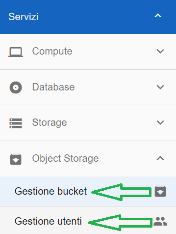

**Lavorare con gli Object Storage**
***********************************

Il servizio BucketaaS si basa, attualmente, sulla piattaforma Netapp Storagegrid dove sono presenti i seguenti costrutti generali:

- Tenant: è legato all'account Nivola. Richiede una quota in GB, in fase di creazione, che è lo spazio massimo utilizzabile da tutti i bucket presenti all’interno del tenant

- User: sono gli utenti presenti all’interno del tenant. Ogni utente può appartenere ad uno o più gruppi e quindi a seconda delle ACL del gruppo può operare in modo diverso sui buckets. Per ogni utente è possibile configurare una coppia accesskey/secretkey utile per l’accesso al bucket tramite protocollo S3

- AccessKey/Secretkey: sono coppie di stringhe che vengono usate dagli applicativi per accedere al bucket o ai buckets all’interno del tenant. Sono legate ad un utente. Sono i parametri da usare per l'accesso al bucket tramite protocollo S3

- Versioning: funzione della piattaforma che permette, se attivata, di versionare (salvare) l’oggetto presente all’interno del bucket. È una funzione attivabile a livello di bucket

- Object Lock: funzione della piattaforma che permette di bloccare un oggetto fino alla scadenza della retention impostata a livello di bucket. È la funzione di compliance mode della piattaforma per rispondere alle esigenze ACN/NIS2. L’attivazione dell’object lock attiva in automatico il versioning su cui in parte si basa

- Retention: indica il numero di giorni per cui il dato versionato deve essere mantenuto prima di poterlo rimuovere. Se si prova a rimuovere l’oggetto senza che la retention sia scaduta si ha un errore. La retention a livello di tenant indica il numero di giorni massimo per quel tenant (e deve essere specificata in fase di creazione del tenant - max 15d) mentre quella a livello di bucket (che non può essere superiore alla prima) indica il numero di giorni a livello di bucket 

- Endpoint esposizione S3: sono le url di esposizione del servizio S3

      - https://storages3.nivolapiemonte.it (da rete internet)

      - https://storages3-rupar.nivolapiemonte.it (da rete rupar)

|

Passi operativi per utilizzo servizio bucketaas:

       - creazione del bucket

       - creazione dell'utente

       - creazione dell'accesskey e secretkey relativo all'utente

       - accesso, tramite gli endpoint indicati, al bucket usando come credenziali accesskey e secretkey 

|

|

.. toctree::
   :maxdepth: 2
 
   14.46c_Lista_Bucket.rst
   14.46d_Dettaglio_Bucket.rst
   14.46e_Creare_Bucket.rst
   14.46f_Aggiornare_Bucket.rst
   14.46g_Cancellare_Bucket.rst
   14.46h_Lista_Utenti_Bucket.rst
   14.46i_Dettaglio_Utente_Bucket.rst
   14.46m_Creare_Utente_Bucket.rst
   14.46n_Cancellare_Utente_Bucket.rst
   14.46p_Concedere_Accesso_Utente_Bucket.rst
   14.46q_Revocare_Accesso_Utente_Bucket.rst
   14.46r_Creare_Chiave_Accesso_Utente_Bucket.rst
   14.46s_Cancellare_Chiave_Accesso_Utente_Bucket.rst
