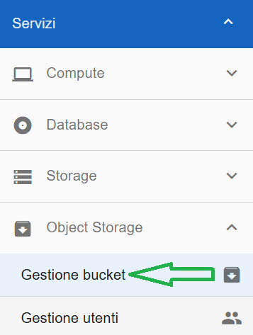
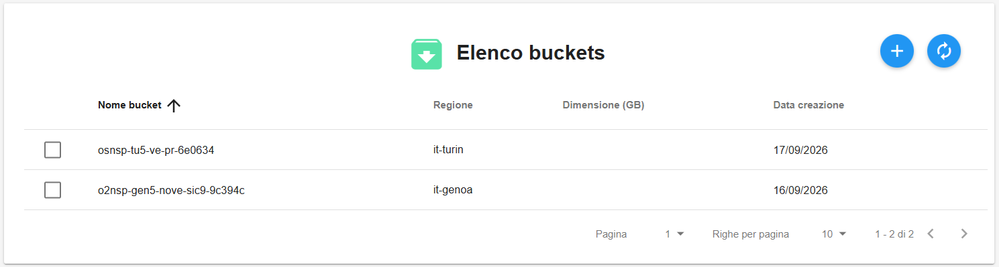
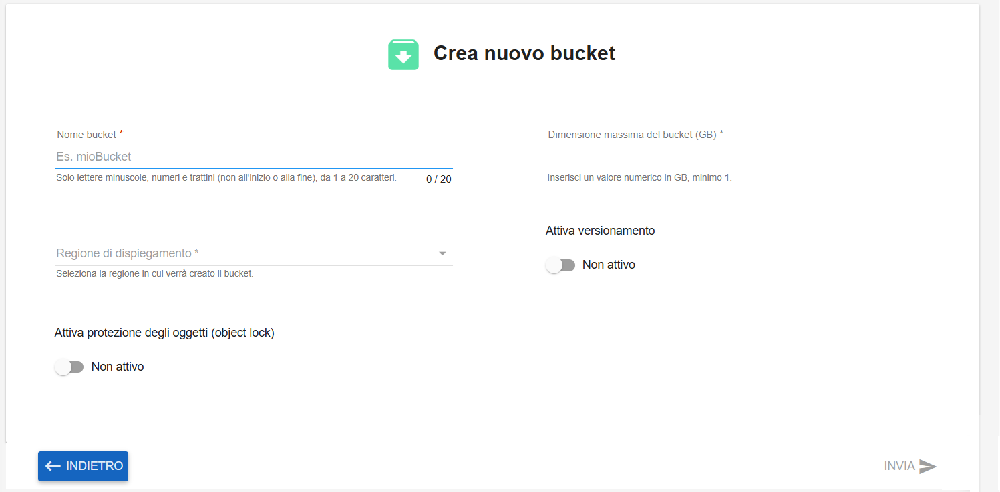
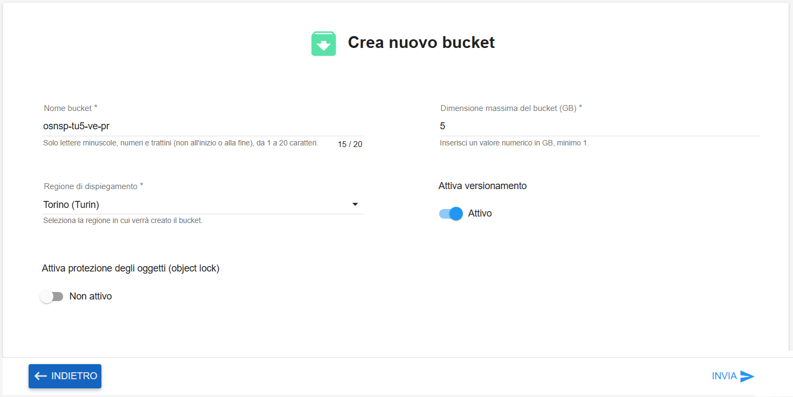
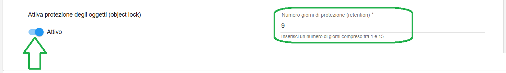
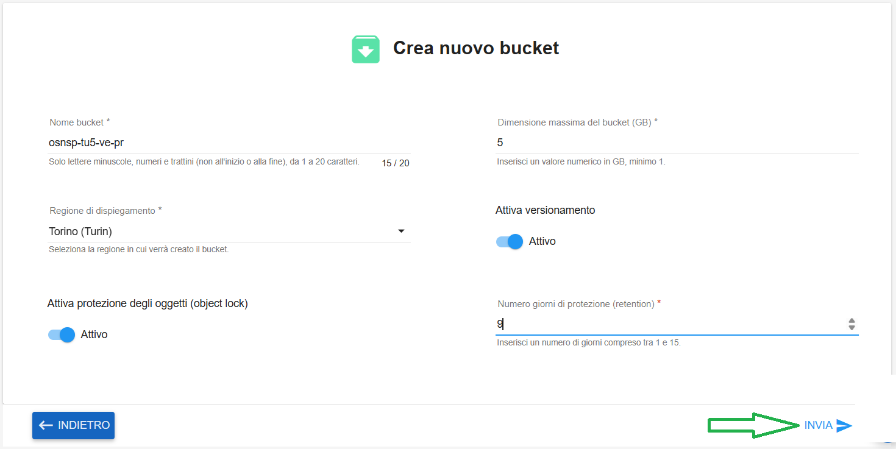

**Creare Bucket**
*****************

Il servizio per la creazione e gestione dei bucket è attivabile dalla parte sinistra dello schermo, cliccando sulla label
**Gestione bucket** sotto **Object Storage**:

|

A seguito di un clic su **Gestione bucket**, il sistema popolerà la parte destra del video con l'**Elenco buckets**:

|

Per la creazione di un bucket, procedere nel seguente modo

Fare clic sul pulsante in alto a destra **Crea nuovo bucket**:

|

Apparirà la seguente pagina:

|

Compilare i campi richiesti e se necessario flaggare le opzioni presenti:

|

Come nell'esempio riportato qui sotto, nel caso si selezioni la voce **Attiva protezione degli oggetti (object lock)**
comparirà automaticamente a fianco la voce **Numero giorni di protezione (retention)**, 
in cui occorrerà inserire il relativo valore numerico:

|

Una volta compilati tutti i campi richiesta, cliccare su INVIA in basso a destra 
(che a fronte delle modifiche inserite sarà diventato selezionabile):

|

Un messaggio in verde in alto a destra darà conferma dell'avvenuta operazione:

|

Una volta terminata la creazione, il bucket creato apparirà nell'elenco:

