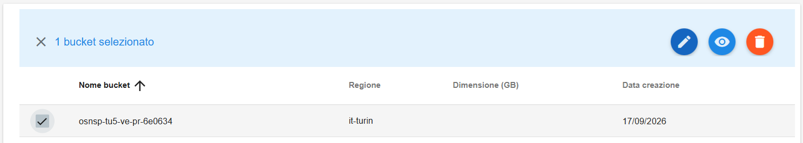
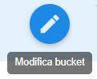
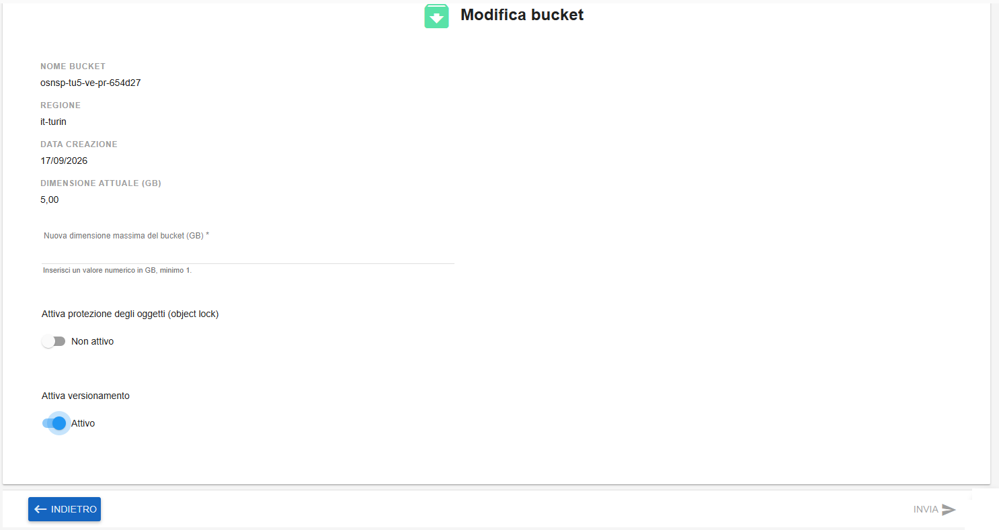
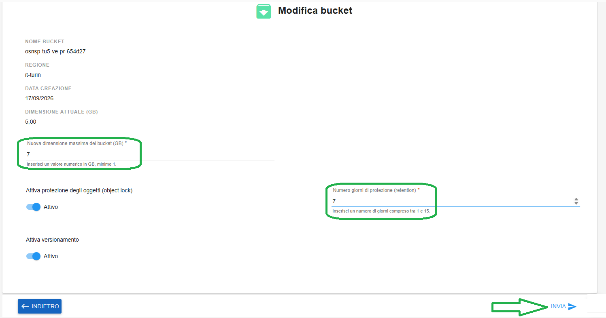
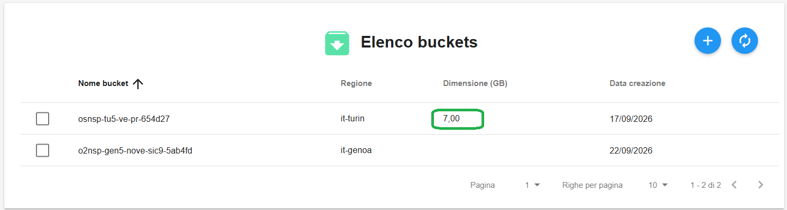

**Aggiornare Bucket**
*********************

Per aggiornare un bucket occorre selezionarne uno:

|

quindi cliccare sull'icona in alto a destra "**Modifica bucket**":

|

Apparirà la seguente pagina:

|

Inserire le modifiche necessarie, come da esempio:

|

Il tasto INVIA in basso a destra diventerà cliccabile. Cliccarlo per salvare la configurazione appena inserita.

Un messaggio in verde in alto a destra darà conferma dell'avvenuta operazione:

|

Aggiornando la lista dopo il termine dell'operazione, i dati appariranno aggiornati:

