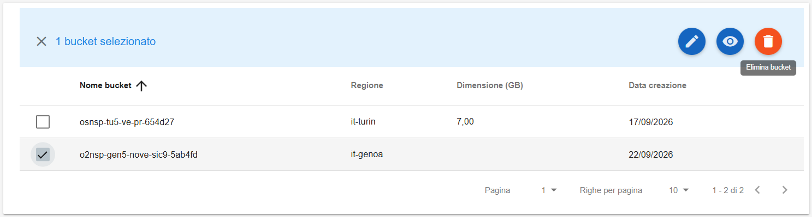
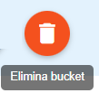
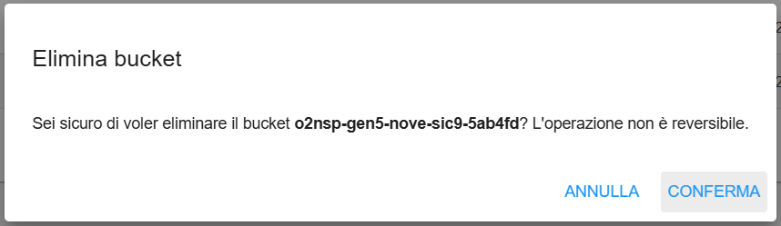

**Cancellare Bucket**
*********************

Selezionare il bucket che si desidera cancellare:

|

Quindi cliccare sul bottone **Elimina bucket**:

|

Verrà aperta la finestra di cancellazione:

|

Quindi cliccare su CONFERMA. Un messaggio in verde in alto a destra darà conferma dell'avvenuta operazione:

