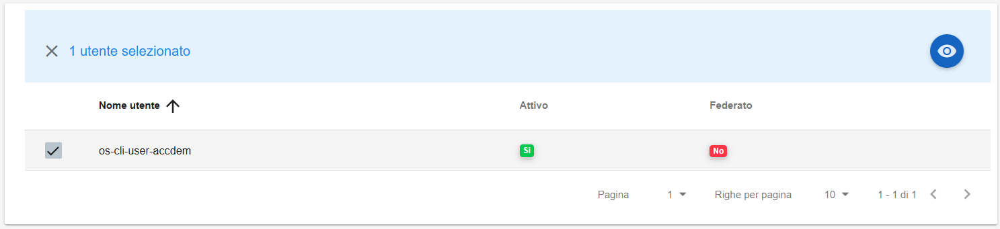
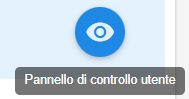
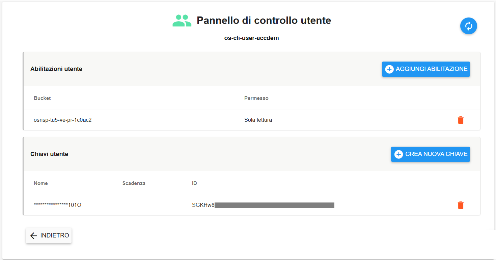

**Dettaglio Utente Bucket**
***************************

Il servizio per visualizzare il dettaglio di un utente bucket è 
attivabile dalla parte sinistra dello schermo, cliccando sulla label **Gestione utenti** sotto **Object Storage**.

.. image:: img/14.46h_Lista_Utenti_Bucket1.png

|

A seguito di un clic su **Gestione utenti**, il sistema popolerà la parte destra del video con la lista degli utenti relativi ai bucket:

.. image:: img/14.46h_Lista_Utenti_Bucket2.png

|

Selezionare un utente:

|

Quindi cliccare sull'icona in alto a destra "**Pannello di controllo utente**":

|

Si accederà alla pagina **Pannello di controllo utente** in cui sono visibili le relative abilitazioni e chiavi:

