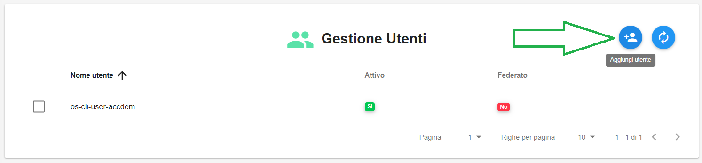
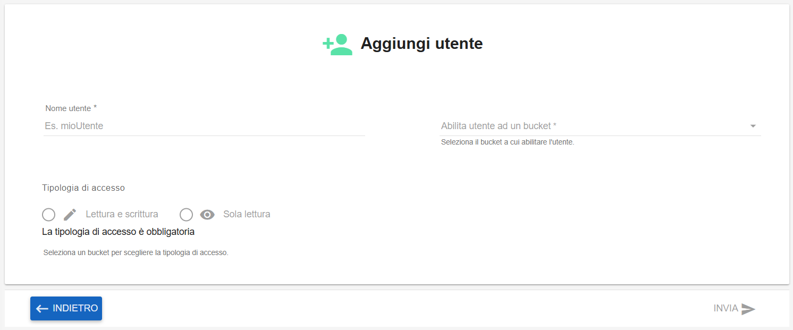
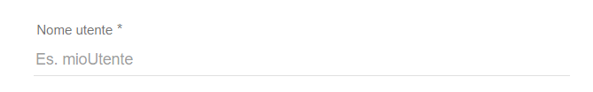
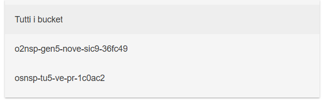
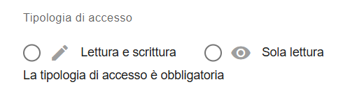
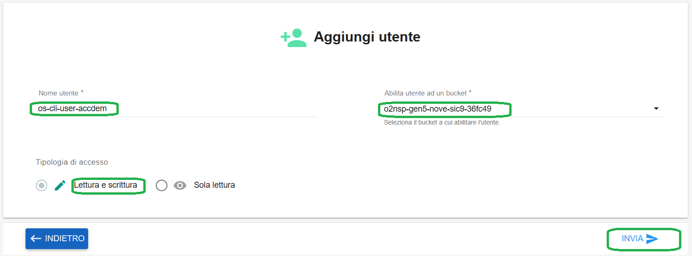
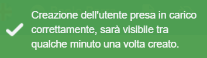
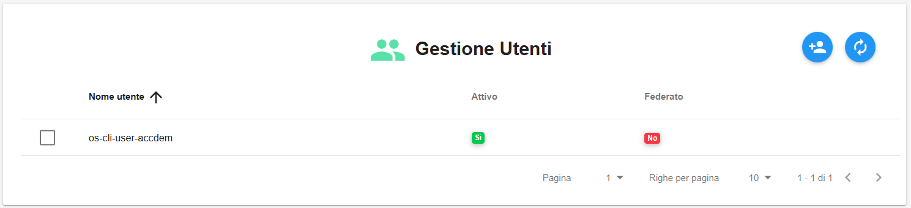

**Creare Utente Bucket**
************************

Il servizio per la creazione e gestione degli utenti bucket è attivabile dalla parte sinistra dello schermo, cliccando sulla label
**Gestione utenti** sotto **Object Storage**:

.. image:: img/14.46h_Lista_Utenti_Bucket1.png

|

A seguito di un clic su **Gestione utenti**, il sistema popolerà la parte destra del video con la lista degli utenti relativi ai bucket:

.. image:: img/14.46h_Lista_Utenti_Bucket2.png

|

Cliccare in alto a destra su **Aggiungi utente**":

|

Si accederà alla pagina **Aggiungi utente**:

|

Inserire:

- nome utente

|

- indicare il singolo bucket a cui associare l'utente in creazione, oppure al contrario "Tutti i bucket" se necessario

|

- selezionare la tipologia di accesso: "Lettura e scrittura" oppure "Sola lettura"

|

A fronte della compilazione dei campi, il tasto INVIA in basso a destra diventerà cliccabile:

|

Cliccarlo per lanciare la creazione dell'utente.
Un messaggio in verde in alto a destra darà conferma dell'avvenuta operazione:

|

Al termine della creazione, l'utente apparirà in elenco:

