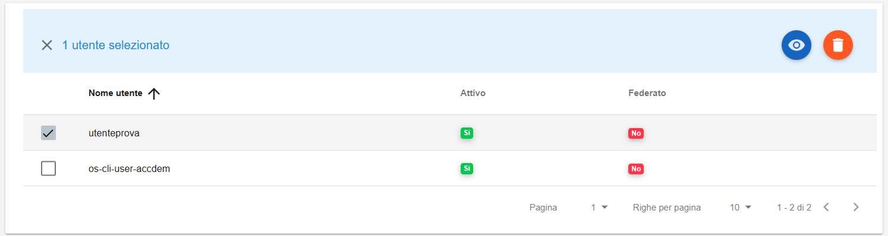
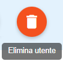
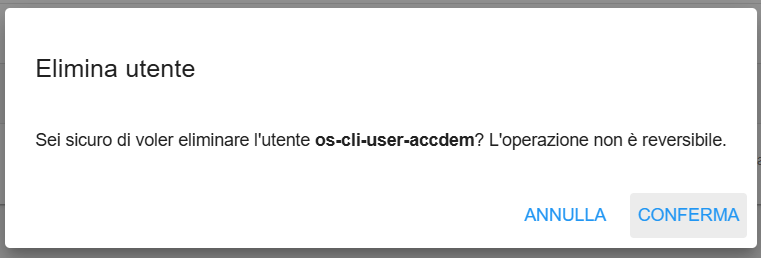

**Cancellare Utente**
*********************

Il servizio per la cancellazione di un utente bucket è attivabile dalla parte sinistra dello schermo, cliccando sulla label 
**Gestione utenti** sotto **Object Storage**:

.. image:: img/14.46h_Lista_Utenti_Bucket1.png

|

A seguito di un clic su **Gestione utenti**, il sistema popolerà la parte destra del video con la lista degli utenti relativi ai bucket:

.. image:: img/14.46h_Lista_Utenti_Bucket2.png

|

Selezionare l'utente che si desidera cancellare:

|

Quindi cliccare sul bottone **Elimina utente** in alto a destra:

|

Verrà aperta la finestra di cancellazione:

|

Quindi cliccare su CONFERMA. Un messaggio in verde in alto a destra darà conferma dell'avvenuta operazione:

