**Concedere accesso a utente Bucket**
*************************************

Il servizio per concedere gli accessi a un utente bucket è attivabile dalla parte sinistra dello schermo, cliccando sulla label
**Gestione utenti** sotto **Object Storage**:

.. image:: img/14.46h_Lista_Utenti_Bucket1.png

|

A seguito di un clic su **Gestione utenti**, il sistema popolerà la parte destra del video con la lista degli utenti relativi ai bucket:

.. image:: img/14.46h_Lista_Utenti_Bucket2.png

|

Selezionare un utente e cliccare su **Pannello di controllo utente**:

.. image:: img/14.46p_2.png

|

Si accederà alla pagina **Pannello di controllo utente**, quindi cliccare su "AGGIUNGI ABILITAZIONE" in alto a destra:

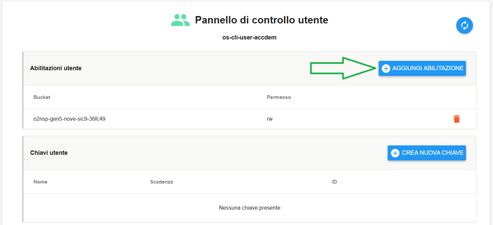

|

Si aprirà la sottofinestra **Aggiungi permessi a bucket**:

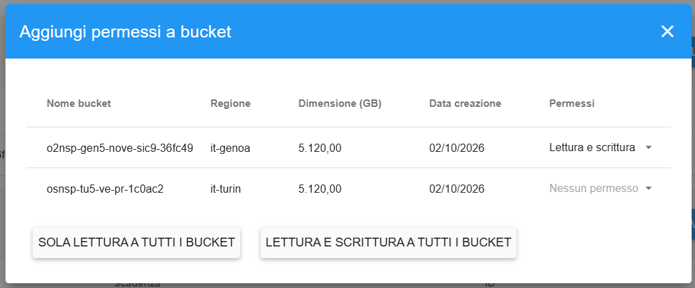

|

I bucket che hanno già un utente impostato, sotto la colonna **Permessi** visualizzano il tipo di permesso presente ("Lettura e scrittura" oppure "Sola lettura"):

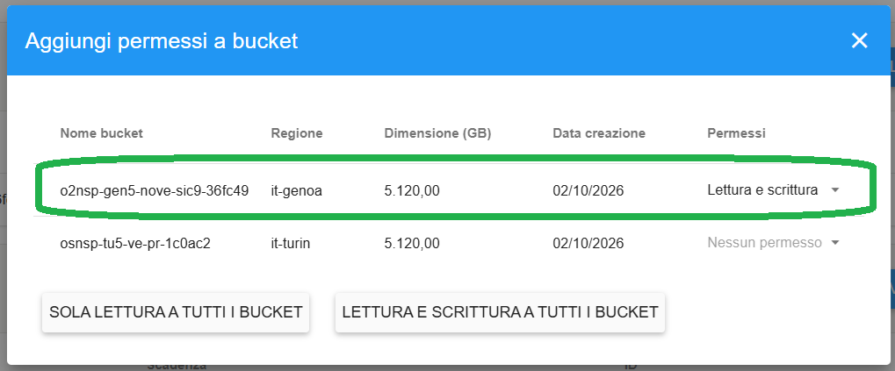

|

Invece i bucket che che non hanno un utente impostato, sotto la colonna **Permessi**, visualizzano la voce "Nessun permesso":

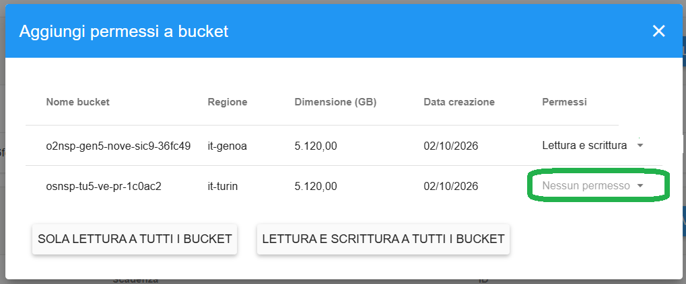

|

Per modificare un permesso già esistente (in questo caso "Lettura e scrittura"), cliccare sulla piccola freccia indicata:

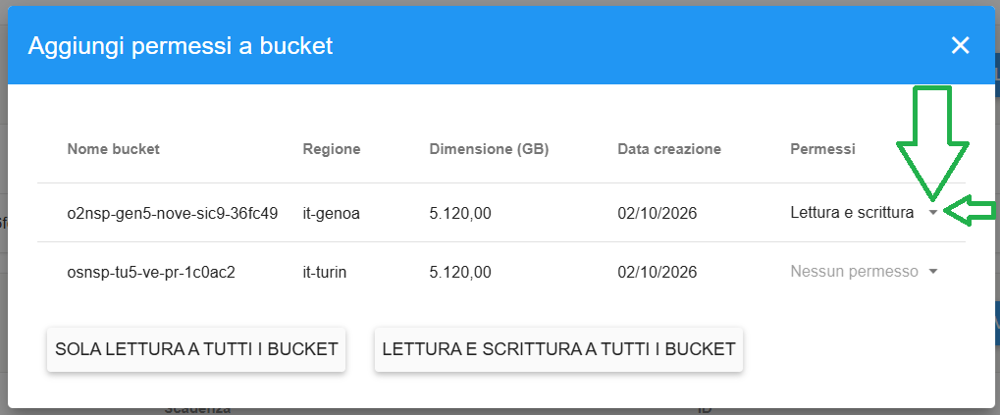

|

Selezionare quindi la voce esclusiva a quella presente (in questo caso "Sola lettura"):

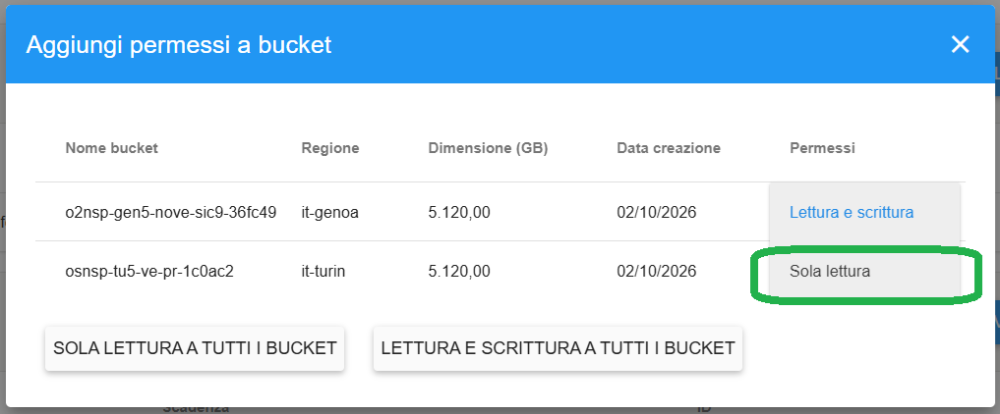

|

Selezionandola, si avvia la modifica del permesso e che sarà seguita da un messaggio in verde di conferma in alto a destra:

|

Allo stesso modo, per modificare un permesso non ancora impostato cliccare sulla piccola freccia indicata:

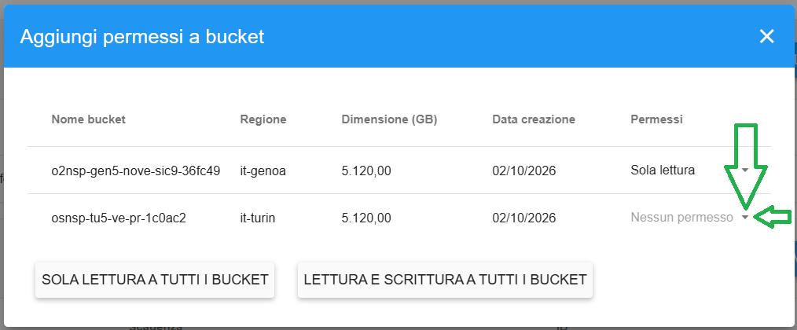

|

Selezionare una delle due voci possibili: "Lettura e scrittura" oppure "Sola lettura":

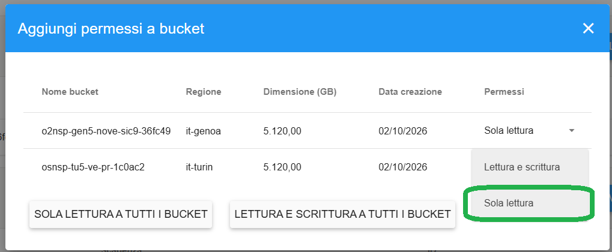

|

Un messaggio in verde in alto a destra darà conferma dell'avvenuta operazione:

|

Come indicato, è anche possibile concedere l'accesso all'utente a tutti i bucket con un singolo click. 
In tal caso è necessario cliccare su "SOLA LETTURA A TUTTI I BUCKET" oppure "LETTURA E SCRITTURA A TUTTI I BUCKET".
L'operazione avrà effetto immediato, confermata dal messaggio verde in alto a destra, e dal cambio delle label dei bucket:

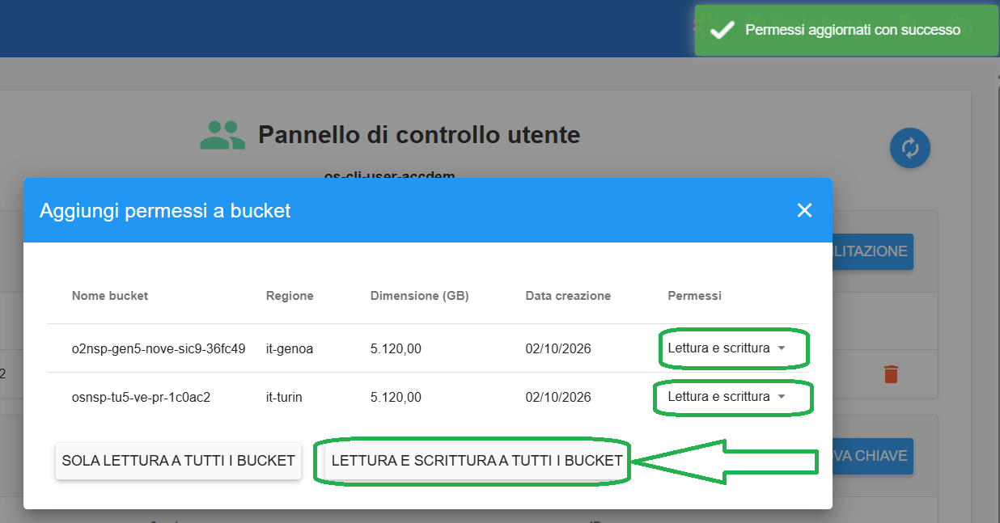

Si segnala che in caso venga concesso l'accesso a tutti i bucket, come appena descritto, il pulsante AGGIUNGI ABILITAZIONE non sarà più selezionabile:

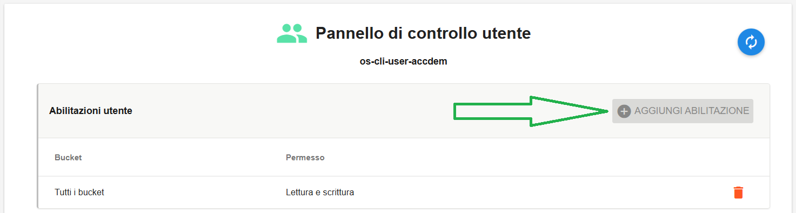

Se occorresse passare da un accesso a tutti i bucket ad un accesso specifico verso un singolo bucket, occorre prima eliminare l'accesso esistente 
e il pulsante AGGIUNGI ABILITAZIONE diventerà nuovamente selezionabile.

|

Chiudendo la finestra, si torna alla pagina "Pannello di controllo utente" in cui sono visibili gli accessi utente appena creati/modificati:

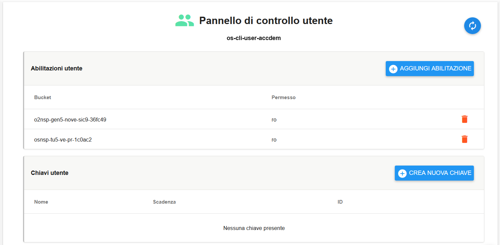
