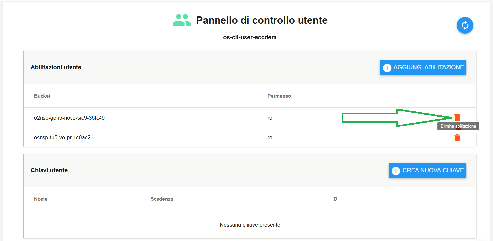
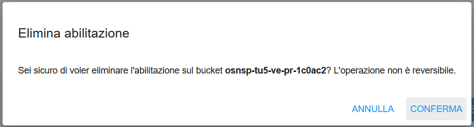
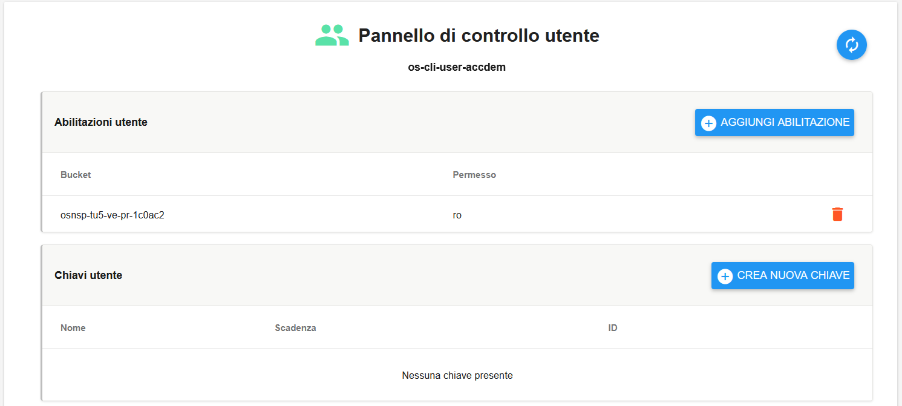

**Revocare accesso a utente Bucket**
====================================

Il servizio per revocare gli accessi a un utente bucket è attivabile dalla parte sinistra dello schermo, cliccando sulla label
**Gestione utenti** sotto **Object Storage**:

.. image:: img/14.46h_Lista_Utenti_Bucket1.png

|

A seguito di un clic su **Gestione utenti**, il sistema popolerà la parte destra del video con la lista degli Utenti relativi ai Bucket:

.. image:: img/14.46h_Lista_Utenti_Bucket2.png

|

Selezionare un utente e cliccare su "Pannello di controllo utente":

.. image:: img/14.46p_2.png

|

Si accederà alla pagina **Pannello di controllo utente**: individuare l'abilitazione utente da eliminare, e cliccare sul simbolo 
del cestino arancione sulla destra, la cui descrizione passandoci sopra col mouse è **Elimina abilitazione**:

|

Confermare l’eliminazione premendo sul pulsante CONFERMA:

|

Un messaggio in verde in alto a destra darà conferma dell'avvenuta operazione:

|

Chiudendo la finestra, si torna alla pagina "Pannello di controllo utente" in cui, al termine dell'eliminazione, l'abilitazione 
non risulterà più presente:

