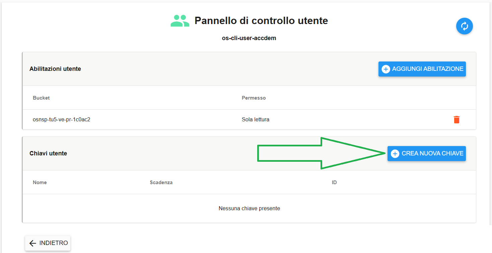
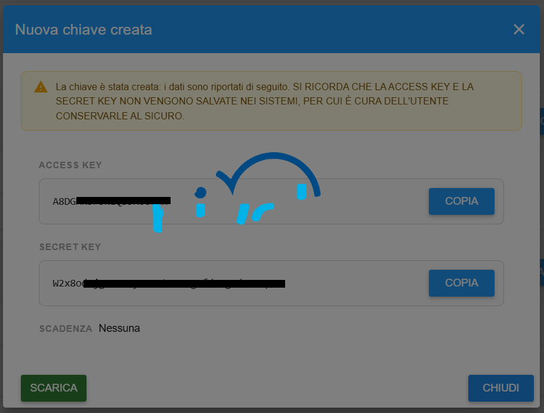
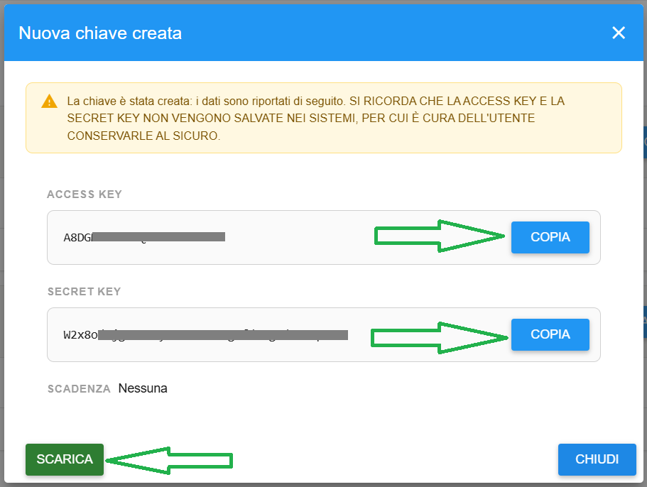
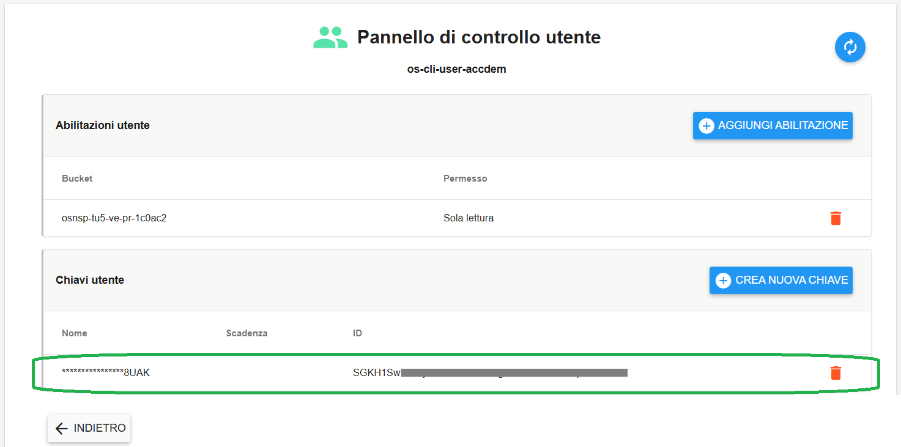

**Creare Chiave Accesso Utente**
********************************

Il servizio per la creazione delle **Chiavi utente** è attivabile dalla parte sinistra dello schermo, cliccando sulla label
**Gestione utenti** sotto **Object Storage**:

.. image:: img/14.46h_Lista_Utenti_Bucket1.png

|

**Attenzione: quando si autorizza un utente ad accedere ad un bucket (o più bucket) è necessario rigenerare una nuova coppia di chiavi per  permettere l'accesso al bucket. 
Le chiavi generate in precedenza infatti non avranno le autorizzazioni per accedere al bucket appena autorizzato ma l'avranno per quelli precedenti.**

|

A seguito di un clic su **Gestione utenti**, il sistema popolerà la parte destra del video con la lista degli Utenti relativi ai Bucket:

.. image:: img/14.46h_Lista_Utenti_Bucket2.png

|

Le chiavi sono associate ad un utente, per cui per poter creare una chiave deve essere presente almeno un utente, che andrà selezionato:

.. image:: img/14.46p_2.png

|

Si accederà alla pagina **Pannello di controllo utente**, quindi cliccare su **CREA NUOVA CHIAVE** in alto a destra:

|

Comparirà la seguente schermata in caricamento fino a operazione conclusa:

|

Al termine, la chiave è stata creata e la pagina diventa interagibile. Nello specifico è possibile:

- copiare l'Access Key

- copiare la Secret Key

- scaricare l'intera chiave

|

Cliccando su CHIUDI si torna al menù precedente, e la chiave creata apparirà nell'elenco:

