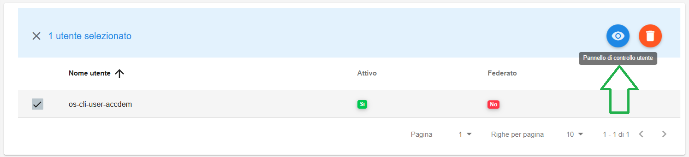
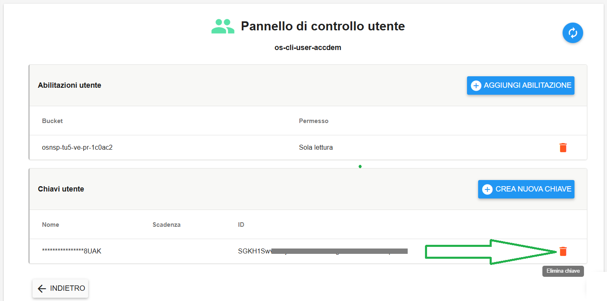
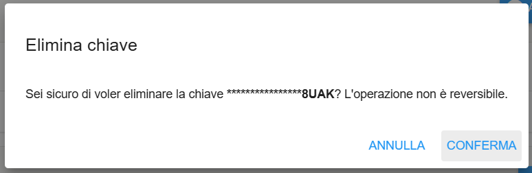

**Cancellare Chiave Accesso Utente**
************************************

Il servizio per la cancellazione delle **Chiavi utente** è attivabile dalla parte sinistra dello schermo, cliccando sulla label
**Gestione utenti** sotto **Object Storage**:

.. image:: img/14.46h_Lista_Utenti_Bucket1.png

|

A seguito di un clic su **Gestione utenti**, il sistema popolerà la parte destra del video con la lista degli Utenti:

.. image:: img/14.46h_Lista_Utenti_Bucket2.png

|

Selezionare l'utente all'interno del quale è necessario cancellare la chiave, 
quindi cliccare su **Pannello di controllo utente**:

|

Individuare la chiave che si desidera cancellare, e cliccare sul pulsante sulla destra a forma di cestino arancione 
la cui descrizione è **Elimina chiave**):

|

Verrà aperta la finestra di cancellazione:

|

Quindi cliccare su CONFERMA. Un messaggio in verde in alto a destra darà conferma dell'avvenuta operazione:

